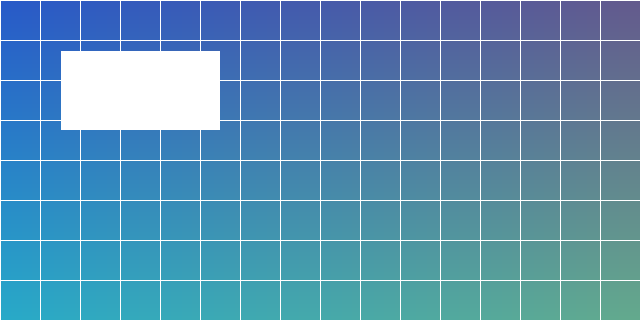

# Setup

## Install the CLI

Run `npm i -g acme`. Then see [[Getting Started]] and [[overview]].

Sibling by relative path: [[./advanced]]. Parent: [[../architecture]].

| Option | Meaning |
| ------ | ------- |
| `-v`   | verbose |

- [x] done
- [ ] todo

TODO: document installation on Windows

A `TODO` inside code is ignored, and so is this fence:

```
TODO: not a real todo
```

- [x] TODO already finished item

## Screenshots

An Obsidian-style embed found by name: ![[overview.png]]

Sized to 320px wide, with alt text: ![[overview.png|Overview screenshot|320]]

Standard Markdown works too, and so does the `|width` suffix: 

This one lives in `media/`, outside the `include` globs, and is still copied: ![[media/outside.png|240]]

A missing image shows a marker and a build warning: ![[no-such-image.png]]
