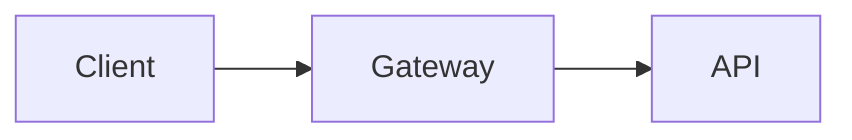

# Markdown

`dokt` uses Obsidian flavored markdown, not all features supported by Obsidian are supported here but many are, including [[#Diagrams|Mermaid Diagrams]].

## Links

| Input |  What's rendered  |  Description |
| --------- | ------ | ------- |
| `[[docs/guide/setup]]` | `setup` | a link to that file, **showing only its file name**, without the extension |
| `[[setup]]` or `[[guide/setup]]` | `setup` | the same, assuming no other files named `setup` |
| `[[setup\|the setup guide]]` | `the setup guide` | changes how the link renders  |
| `[[setup#Install the CLI]]` | `setup > Install the CLI` | links to a heading in another file  |
| `[[#Install the CLI]]`| `setup > Install the CLI` | a link to a header within the current page |
| `[[./sibling]]`, `[[../other]]` | `sibling`, `other` | links relative to the current page |
| `[text](other.md#part)` | `other > part` |  ordinary Markdown links to pages work too |

- **Resolution order**: a full path from the project root, then the end of a path, then a bare file name. Matching ignores case and the `.md` extension.
- A link to a page that does not exist is shown with a dotted underline and a tooltip, and the outputs a warning to console.

## Images

Images used in your Markdown are automatically copied onto the site, they do not need to be included explicitly. There are a few options for images:

| Input | Result |
| --------- | ------ |
| `![[diagram.png]]` | an embed, like Markdown links it will try to resolve by just filename or can take explicit paths |
| `![[diagram.png\|320]]` | 320 px wide (`\|320x200` sets width and height) |
| `![[diagram.png\|Alt text]]` | alt text (any order with a size: `![[diagram.png\|Alt text\|320]]`) |
| `` | standard Markdown: relative to the page, or `/img/diagram.png` from the project root |
| `` | standard Markdown with the width suffix |
| `[[report.pdf]]`, `[[diagram.png]]` | a plain link to the PDF or image. These will not render but will also be included in the site |

- If an image is missing it renders a dashed marker and prints a warning.
- Images load lazily on the site.
- `![[some note]]` (embedding another note's text) is not supported. It becomes a link, with a warning.

### Supported Image Types
The follow image types are supported:
- png
- jpg
- jpeg
- gif
- svg
- webp
- avif
- bmp
- ico


## Diagrams

A fenced block tagged `mermaid` is drawn by [Mermaid](https://mermaid.js.org/):



````md

````

You can find the docs for Mermaid [here](https://mermaid.ai/open-source/intro/getting-started.html), it supports many different types of charts. Mermaid 11.17 is bundled in the program and written to `assets/mermaid.min.js`, so sites work offline. Diagrams follow the active light or dark theme and are redrawn when you switch.

